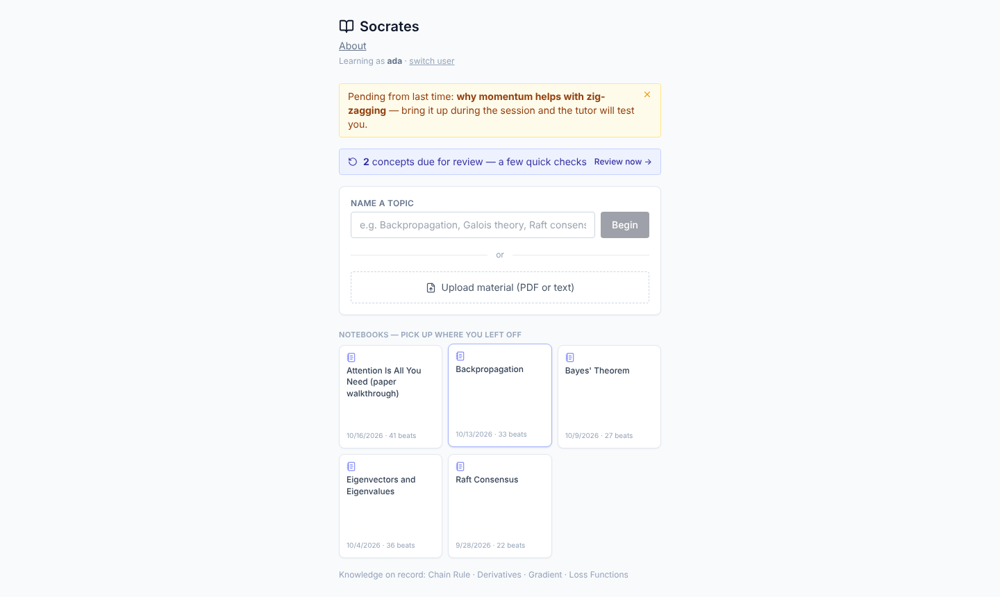
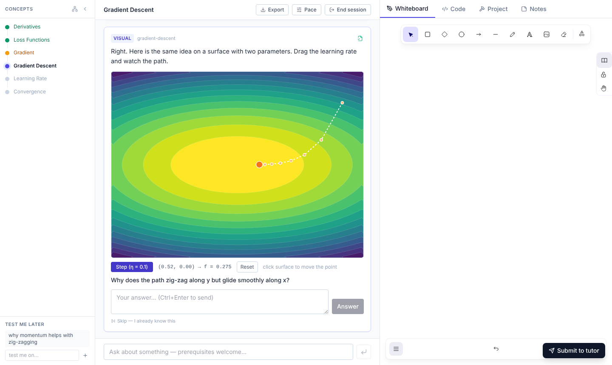
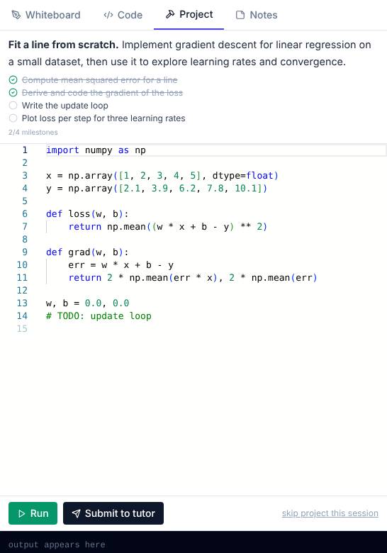
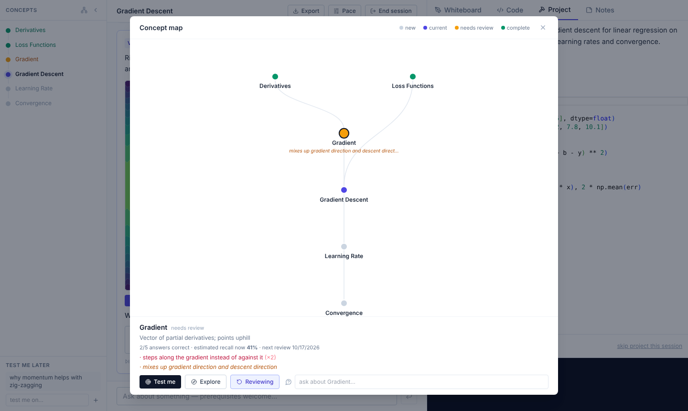
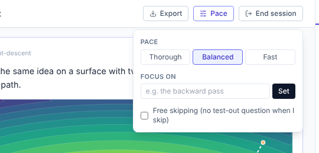

# Socrates

Socrates is a tutor that turns a topic, or your own
material (textbook chapters, lecture slides, PDFs), into an adaptive,
interactive lesson with questions, checks, visuals,
a code and whiteboard workspace, and a concept map that grows as you learn.

## Quick start

Requires Node.js 22.13+ (for its built-in SQLite) and an API key for a model provider: [Anthropic](https://console.anthropic.com/settings/keys) by default, or any OpenAI-compatible API (see [Model providers](#model-providers)).

```bash
git clone https://github.com/turquoise5/socrates.git
cd socrates
npm install
cp .env.example .env   # then put your API key in .env
npm run dev
```

Open http://localhost:5173 and create your account. The first account can
always be created; after that, sign-ups are closed unless `ALLOW_SIGNUP=true`.

## Using Socrates

### Start a lesson

Name a topic, or upload material (PDF, text or Markdown). Socrates maps out
the concepts involved and their prerequisites, then teaches them one at a
time. With uploaded material, the tutor quotes it with page references and
can show the original page when a figure explains something best.



The start screen also lists your **notebooks** (past lessons you can reopen
where you left off) and any concepts **due for review**.

### The lesson

The lesson is a sequence of short steps: explanations, interactive visuals
(plots with sliders, networks you click, small simulations), questions,
exercises and checks. Answer in the box under each question. The tutor
won't just hand over answers; it gives hints, worked parallel examples and
counterexamples until you get there.



- **Ask anything** in the box at the bottom, including prerequisites. The
  tutor answers as a tangent and then returns to where you were.
- **Skip — I already know this** on any step gives you one test-out question
  instead. Turn on free skipping in the Pace menu to skip without it.

### Workspace

The right-hand panel is where you do the work. When a step asks for it, the
matching tab opens; **Submit to tutor** sends your work for feedback.



- **Whiteboard** for sketches, diagrams and derivations. The tutor sees the
  drawing.
- **Code** runs Python in your browser, so you can test before submitting.
- **Project**: early in each lesson the tutor proposes a small project
  that grows milestone by milestone as you learn, so exercises add up to
  something instead of being thrown away. You can decline it.
- **Notes** is your own space, in Markdown. The tutor reads it only when you
  submit, for example when it asks you to summarise a concept in your own
  words.

### Concept map

The left rail lists the lesson's concepts and their status (new, current,
needs review, complete); click one to jump there. Open the full **concept
map** to see how the concepts depend on each other. It grows as you go:
when a question reveals a missing prerequisite, that prerequisite joins the
map. Select a concept to be tested on it, explore it further, ask about it,
see your record on it (answers correct, estimated recall, misconceptions),
or mark it **Keep reviewing**.



Below the rail, **Test me later** collects things you want to be quizzed on
before the lesson ends.

### Pace and focus

The **Pace** menu sets how deep the lesson goes: *thorough* (more practice
per concept), *balanced* or *fast* (denser explanations, fewer checks). You
can also name a **focus** ("the intuition, not the proofs"), and the tutor
spends more time on it and skims the rest. Changes apply straight away.



### Ending and exporting

**End session** saves the lesson to your record and notebooks. If anything
is still shaky or waiting in Test me later, Socrates offers a short final
review first.

**Export** downloads the lesson as Markdown: every step with your answers,
whiteboard sketches as images, code with its output, your notes and
summaries, and the project. Click the file icon on any step to leave it out.
The file imports cleanly into Obsidian or Notion and renders on GitHub.

## How Socrates remembers you

- **Learner model.** The tutor grades each answer as correct, partial or
  incorrect, and code turns those grades into a mastery estimate per concept
  and a forgetting curve, so "how well do they know this" is computed rather
  than guessed.
- **Weaknesses.** Wrong answers can record a misconception on a concept. When
  a mistake comes from a missing prerequisite (an algebra slip inside a
  calculus problem), the prerequisite is added to the concept map and graded
  instead, so the weakness carries into future lessons.
- **Spaced review is opt-in.** Mark a concept "Keep reviewing" in the concept
  map and it comes back as a quick check when it's due. One-off sessions,
  like walking through a paper, are never scheduled.
- **Only relevant history goes to the model.** Each request carries the
  concepts near today's lesson in the prerequisite graph (with mastery and
  misconceptions), a one-line index of everything else, and a short learner
  profile rewritten after each lesson. Old transcripts stay in your notebooks
  and are not sent, so cost per turn doesn't grow with your history.

## Configuration

Set these in `.env`:

| Variable        | Required | Description                                                              |
| --------------- | -------- | ------------------------------------------------------------------------ |
| `PROVIDER`      | no       | `anthropic` (default) or `openai` (any OpenAI-compatible API).           |
| `API_KEY`       | yes\*    | Your provider's API key. `ANTHROPIC_API_KEY` also works.                 |
| `MODEL`         | \*\*     | Model ID. Defaults to `claude-opus-5-5` on Anthropic; required for `openai`. |
| `API_BASE_URL`  | no       | `openai` only: the API endpoint (default `https://api.openai.com/v1`).   |
| `MAX_TOKENS`    | no       | `openai` only: output token cap (default: the model's own limit).        |
| `EFFORT`        | no       | `anthropic` only: `low` (default), `medium` or `high`.                   |
| `ALLOW_SIGNUP`  | no       | `true` lets anyone who can reach the server create an account.           |
| `COOKIE_SECURE` | no       | `true` when serving over HTTPS.                                          |
| `PROXY_PORT`    | no       | Port for the API server in development (default `3001`).                 |

\* Not needed for local servers such as Ollama. \*\* Required when `PROVIDER=openai`.

## Model providers

**Anthropic (default)** gives the full experience: the tutor checks its
arithmetic with a built-in calculator, looks up facts with web search, and
the large system prompt is cached so repeat turns are cheaper and faster.

**Any OpenAI-compatible API** works with `PROVIDER=openai`:

| Provider   | `API_BASE_URL`                                              | Example `MODEL`              |
| ---------- | ----------------------------------------------------------- | ---------------------------- |
| OpenRouter | `https://openrouter.ai/api/v1`                              | `anthropic/claude-sonnet-5.5` |
| OpenAI     | `https://api.openai.com/v1` (default)                       | your OpenAI model ID         |
| Gemini     | `https://generativelanguage.googleapis.com/v1beta/openai`   | your Gemini model ID         |
| Ollama     | `http://localhost:11434/v1`                                 | `llama3.1`                   |

On these the calculator and web search are unavailable, so the tutor
verifies by reasoning instead. The tutor depends on the model returning a
well-formed JSON object every turn, so small local models may struggle;
mid-size and larger models work best. OpenRouter also serves Claude models,
so you can use Claude through it with a single OpenRouter key (without the
Anthropic-only tools).

## How it works

- `server.js` is a small Express server that proxies requests to the model
  provider (your key never reaches the browser) and stores per-user state.
  `llm.js` translates between the app and each provider's API.
- `src/` is a React + Vite client. The tutor's behaviour lives in
  `src/prompts/tutor.ts`.
- Everything is stored in one SQLite file, `data/socrates.db`, using Node's
  built-in `node:sqlite`, so there is no database server to run. Back up the
  `data/` folder to keep your history.
- Signing in creates a server-side session. Without "keep me signed in" the
  cookie ends when the browser closes; logging out ends the session
  immediately.

## Production

```bash
npm run build
NODE_ENV=production PORT=8080 npm start
```

One process serves both the built client and the API.

Everything that spends your API key or touches saved state requires a
signed-in account. Every account uses your API key, so only turn on
`ALLOW_SIGNUP` for people you're happy to pay for. Serve it over HTTPS (and
set `COOKIE_SECURE=true`) if it's reachable from the internet.

## License

[MIT](LICENSE)
